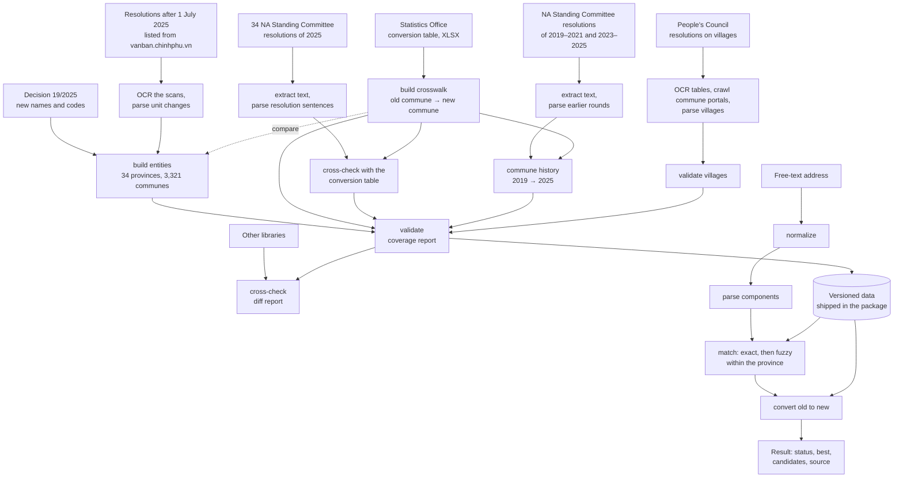
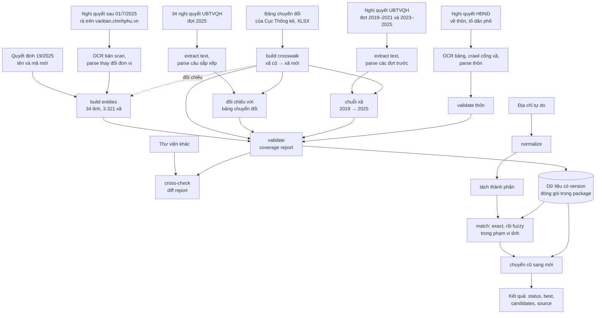

# VnAddr

**English** | [Tiếng Việt](#tiếng-việt)

A Python library that converts Vietnamese addresses from the old administrative system (63 provinces, 3 levels) to the system in force since 1 July 2025 (34 provinces, 2 levels), down to the village, with the mapping built from the legal documents themselves.

## Why

Since 1 July 2025, Vietnam has 34 provincial-level and 3,321 commune-level administrative units, and the district level no longer exists. Every system that stores addresses (CRM, logistics, KYC, e-commerce, public data) holds records in the old format that need converting.

The new names and codes are published in Decision 19/2025/QĐ-TTg. Which old communes became which new ones is set out in 34 resolutions of the National Assembly Standing Committee, one per province, written as legal prose, for example:

> *Sắp xếp toàn bộ diện tích tự nhiên, quy mô dân số của xã E và một phần diện tích tự nhiên, quy mô dân số của xã F thành xã mới có tên gọi là xã G.*
> (The whole area and population of commune E and **part** of commune F are merged into a new commune named G.)

The Statistics Office also publishes an official conversion table from old communes to new ones (a spreadsheet of about 10,600 rows, with codes), but it does not say which article or clause each change comes from.

Villages (thôn, xóm, tổ dân phố) change too. They are not administrative units: People's Councils merge and rename them (provincial councils before 2025, each commune's council in 2026), sometimes more than once. For example, An Lễ village in the old Liên Minh commune (Vụ Bản district, Nam Định) became Nhất Giáp and is now Hào Kiệt village, Liên Minh commune, Ninh Bình. Converting only the province and commune leaves the old village name in the address.

Several libraries already convert addresses; VnAddr differs in tracing every commune row to both official sources, in how it reports communes that were split, and in converting villages as well.

## What it returns

For a free-text address such as `70 nguyễn sỹ sách, p.15, Tân Bình, Tp.HCM`, the result gives the new province, commune and village, a status, the candidates considered and the legal source of the mapping:

| Status | Meaning |
|---|---|
| `unchanged` | The commune was not reorganised |
| `renamed` | Only the name changed |
| `merged_full` | The whole old commune belongs to one new commune |
| `split_partial` | The old commune was split; extra information (street, coordinates) picked one candidate |
| `ambiguous` | The old commune was split and the input does not say which part |
| `not_found` | The address could not be recognised |

- **One source per mapping row.** Each result carries the resolution, article and clause it comes from, in the form `<number>/NQ-UBTVQH15, Điều 1, khoản 2`.
- **Candidates, not a single guess.** When a commune was split, every new commune it went into is returned with a score and a reason.
- **Village history.** When a village was merged or renamed, the result lists each name it went through, with the resolution and effective date.

## Architecture

- **Two official sources for every commune row:** the Statistics Office's conversion table gives the old → new pairs with codes, and the resolution gives the article and clause. The resolutions are parsed and checked against the table (for Ho Chi Minh City and Ninh Bình, 896 of 898 pairs agree, including whether the old commune was merged whole or in part); any disagreement becomes a report to review rather than a silent choice. The trade-off is that the table carries no document number or date, so each downloaded copy is recorded by its SHA-256 and later corrections from the Statistics Office have to be tracked.
- **Villages come from a second set of sources:** People's Council resolutions (provincial before 2025, communal in 2026), as appendix tables or numbered clauses, with an effective date for each change, so a village renamed twice is followed to its current name. The trade-off is uneven coverage: these resolutions are spread over many provincial and commune websites, some only as scans that need OCR, and where data is missing the village name is kept as written and the result says it was not converted.
- **The build pipeline is separate from the package:** fetching, extraction and parsing run once per data release and are not installed with the library. The package only ships the validated data, loaded on first use rather than at import.
- **Matching goes from cheap to expensive:** exact lookup on (province, district, commune), then (province, commune), then without diacritics, and only then fuzzy matching, limited to the province already identified. Limiting the search keeps it fast and avoids matching a name from another province; the trade-off is that a province that cannot be recognised has to be resolved first, by fuzzy matching on the province names.
- **Old-format input needs the old district:** names such as `Phường 15` exist in many districts, so the parser keeps the district even though the new system no longer has one.
- **Data is versioned by date**, for example `2025.07.01-r1`, so a later change to a unit (such as the communes made wards in 2026) becomes a new data release, and the same input with the same data version always gives the same result.

## Goals

**Product**

1. Build the old → new commune mapping for all 34 provinces from the Statistics Office's conversion table, with the resolution, article and clause on every row.
2. Build the old → new village mapping from People's Council resolutions, following every change in order, for each province whose resolutions are published.
3. Convert free-text addresses, including messy ones (no diacritics, abbreviations, typos, missing levels), and return a status, candidates and source.
4. Convert in batch: a vectorised API for Polars and pandas, and a DuckDB UDF (`vn_addr_convert`).
5. Provide a CLI to convert a single address or a CSV file.
6. Publish an evaluation dataset of messy addresses and the accuracy of VnAddr and other libraries on it.

**Engineering**

- Validate the data: every new commune resolves to a code in Decision 19/2025, every old commune is mapped at least once, and the national total is 3,321. Gaps are listed in a coverage report, not skipped. Village coverage is reported per province.
- Never raise an exception on bad input; return `not_found` instead.
- Measure throughput: operations per second for single addresses and rows per second for a batch of one million.
- Keep the core light: `rapidfuzz` is the only required dependency; Polars, pandas and DuckDB are optional.

**Out of scope**

- Using another library's data as the source of the mapping. Other libraries are used only for cross-checking.
- Real addresses of people or companies in the evaluation dataset. It is generated from standard addresses, or taken from public sources.
- Checking that a house number or street exists.

## Design principles

- **Trace, don't trust.** A mapping row without a source document and clause is not shipped. Data is generated by the pipeline, never typed by hand.
- **Say ambiguous, don't guess.** When part of an old commune went to several new ones and the address does not say which part, the result is `ambiguous` with all candidates. A confident wrong answer is worse than an honest "not sure", because it silently corrupts migrated data.
- **Codes are strings.** Province codes have 2 digits and commune codes 5 (`01` Hà Nội, `79` Hồ Chí Minh City); leading zeros are kept.

## Sources

| Document | Content | Used for |
|---|---|---|
| Decision 19/2025/QĐ-TTg | List and codes of the 34 provinces and 3,321 communes | New entities |
| Resolutions after 1 July 2025: 237/NQ-UBTVQH16 and 388/NQ-UBTVQH16 (communes made wards in Đồng Nai and Bắc Ninh), 30/2026/QH16, 36/2026/QH16 and 39/2026/QH16 (Đồng Nai, Quảng Ninh and Bắc Ninh made cities) | Changes to the units of Decision 19/2025; codes are kept | Current type of each new entity, and the date it changed |
| 34 resolutions of the NA Standing Committee (in force 16 June 2025) | Which old communes form each new commune | Article and clause of each commune row; cross-check |
| Earlier resolutions of the NA Standing Committee: 2019–2021 (…/NQ-UBTVQH14, 70 documents) and 2023–2025 (…/NQ-UBTVQH15, 60 documents) | Communes merged, renamed or made wards, boundaries adjusted, districts merged or formed | Each commune of 2019 followed to 2025, for addresses written before the 2025 reorganisation |
| Conversion table, old to new communes (Statistics Office, danhmuchanhchinh.nso.gov.vn) | Old commune (name, code, district) → new commune, whole or part | Commune mapping and list of old communes |
| Resolution 202/2025/QH15 | Reorganisation of provinces (63 → 34) | Province mapping |
| Official Letter 1027/CTK-CSCL (Statistics Office, Ministry of Finance) | Official list and corrections to names and codes | Not applied: it predates Decision 19/2025 (30 June 2025), whose list is used as published |
| Decision 124/2004/QĐ-TTg and later updates | Old list (63 provinces, 3 levels) | Not yet found in machine-readable form; old communes come from the conversion table |
| Resolutions of People's Councils on villages: provincial before 2025 (for example 63/2021/NQ-HĐND, Nam Định), communal in 2026 | Which villages are merged or renamed, and when | Village mapping |

Legal documents and the Statistics Office's tables are public data. Results are cross-checked against [vietnamadminunits](https://github.com/tranngocminhhieu/vietnamadminunits) (MIT), [onflow-location-platform](https://pypi.org/project/onflow-location-platform/), [vietnam-address-converter](https://pypi.org/project/vietnam-address-converter/) and [undertheseanlp/address](https://huggingface.co/undertheseanlp/address).

## Tech stack

Python · rapidfuzz · Polars · pandas · DuckDB · pdfplumber · Beautiful Soup · uv · hatchling

| Role | Library | Required |
|---|---|---|
| Fuzzy matching | rapidfuzz | yes |
| Batch conversion | Polars, pandas | optional |
| SQL conversion | DuckDB | optional |
| Text extraction (pipeline only) | pdfplumber, Beautiful Soup | not installed with the package |

---

# Tiếng Việt

Thư viện Python chuyển địa chỉ Việt Nam từ hệ hành chính cũ (63 tỉnh, 3 cấp) sang hệ áp dụng từ ngày 01/07/2025 (34 tỉnh, 2 cấp), xuống tới cấp thôn, với bảng mapping được xây dựng từ chính các văn bản pháp lý.

## Vì sao

Từ ngày 01/07/2025, Việt Nam có 34 đơn vị hành chính cấp tỉnh và 3.321 đơn vị hành chính cấp xã, cấp huyện không còn. Mọi hệ thống lưu địa chỉ (CRM, logistics, KYC, thương mại điện tử, dữ liệu công) đều đang giữ dữ liệu theo hệ cũ cần chuyển đổi.

Tên và mã mới được ban hành trong Quyết định 19/2025/QĐ-TTg. Xã cũ nào trở thành xã mới nào được quy định trong 34 nghị quyết của Ủy ban Thường vụ Quốc hội, mỗi tỉnh một văn bản, viết dưới dạng văn xuôi pháp lý, ví dụ:

> *Sắp xếp toàn bộ diện tích tự nhiên, quy mô dân số của xã E và **một phần** diện tích tự nhiên, quy mô dân số của xã F thành xã mới có tên gọi là xã G.*

Cục Thống kê có công bố bảng chuyển đổi chính thức từ xã cũ sang xã mới (file Excel khoảng 10.600 dòng, có mã), nhưng bảng không ghi mỗi thay đổi dựa trên điều, khoản nào.

Thôn, xóm, tổ dân phố cũng thay đổi. Đây không phải đơn vị hành chính: HĐND quyết định sáp nhập, đổi tên (HĐND tỉnh với các đợt trước 2025, HĐND từng xã với đợt 2026), có nơi nhiều lần. Ví dụ, thôn An Lễ của xã Liên Minh cũ (huyện Vụ Bản, Nam Định) trở thành thôn Nhất Giáp, hiện nay là thôn Hào Kiệt, xã Liên Minh, tỉnh Ninh Bình. Chỉ chuyển tỉnh và xã thì địa chỉ vẫn mang tên thôn cũ.

Đã có một số thư viện chuyển đổi địa chỉ; VnAddr khác ở chỗ mỗi dòng mapping cấp xã truy được về cả hai nguồn chính thức, ở cách báo kết quả cho các xã bị chia tách, và ở việc chuyển cả cấp thôn.

## Kết quả trả về

Với một địa chỉ tự do như `70 nguyễn sỹ sách, p.15, Tân Bình, Tp.HCM`, kết quả gồm tỉnh, xã và thôn mới, trạng thái, các ứng viên đã xét và nguồn pháp lý của mapping:

| Trạng thái | Ý nghĩa |
|---|---|
| `unchanged` | Xã không thuộc diện sắp xếp |
| `renamed` | Chỉ đổi tên |
| `merged_full` | Toàn bộ xã cũ thuộc một xã mới |
| `split_partial` | Xã cũ bị chia tách; thông tin bổ sung (tên đường, tọa độ) đã chọn được một ứng viên |
| `ambiguous` | Xã cũ bị chia tách và địa chỉ không cho biết thuộc phần nào |
| `not_found` | Không nhận diện được địa chỉ |

- **Mỗi dòng mapping có một nguồn.** Mỗi kết quả kèm nghị quyết, điều và khoản làm căn cứ, dạng `<số>/NQ-UBTVQH15, Điều 1, khoản 2`.
- **Trả danh sách ứng viên, không đoán một kết quả.** Khi một xã bị chia tách, mọi xã mới nhận một phần của nó đều được trả về kèm điểm và lý do.
- **Lịch sử thôn.** Khi thôn bị sáp nhập hoặc đổi tên, kết quả liệt kê từng tên thôn đã qua, kèm nghị quyết và ngày hiệu lực.

## Kiến trúc

- **Mỗi dòng cấp xã có hai nguồn chính thức:** bảng chuyển đổi của Cục Thống kê cho cặp xã cũ → xã mới kèm mã, nghị quyết cho điều, khoản. Nghị quyết được parse và đối chiếu với bảng (với TP.HCM và Ninh Bình, 896/898 cặp khớp, kể cả việc xã cũ được nhập toàn bộ hay một phần); chỗ lệch thành báo cáo để review thay vì âm thầm chọn một bên. Trade-off là bảng không có số hiệu hay ngày ban hành, nên mỗi bản tải về được ghi sha256 và phải theo dõi các lần đính chính của Cục Thống kê.
- **Thôn lấy từ một nguồn thứ hai:** nghị quyết HĐND (tỉnh với các đợt trước 2025, xã với đợt 2026), dạng bảng phụ lục hoặc các khoản đánh số, mỗi thay đổi có ngày hiệu lực, nên thôn đổi tên hai lần vẫn được lần tới tên hiện hành. Trade-off là độ phủ không đều: các nghị quyết này nằm rải rác trên cổng của nhiều tỉnh và xã, có văn bản chỉ là bản scan phải OCR, và chỗ thiếu dữ liệu thì tên thôn được giữ như input, kết quả ghi rõ là chưa chuyển đổi.
- **Pipeline build dữ liệu tách khỏi package:** fetch, extract và parse chạy một lần cho mỗi bản dữ liệu và không được cài cùng thư viện. Package chỉ chứa dữ liệu đã validate, load khi dùng lần đầu chứ không load lúc import.
- **Match đi từ rẻ đến đắt:** exact lookup theo (tỉnh, huyện, xã), rồi (tỉnh, xã), rồi bản bỏ dấu, sau cùng mới fuzzy match, giới hạn trong tỉnh đã xác định. Giới hạn phạm vi giúp chạy nhanh và tránh khớp nhầm tên ở tỉnh khác; trade-off là nếu chưa nhận ra tỉnh thì phải xác định tỉnh trước, bằng fuzzy match trên danh sách tên tỉnh.
- **Địa chỉ theo hệ cũ cần cả huyện cũ:** những tên như `Phường 15` có ở nhiều quận, nên parser giữ lại huyện dù hệ mới không còn cấp này.
- **Dữ liệu có version theo ngày**, ví dụ `2025.07.01-r1`, nên một thay đổi đơn vị về sau (như các xã lên phường năm 2026) thành một bản dữ liệu mới, và cùng input với cùng version dữ liệu luôn cho cùng kết quả.

## Mục tiêu

**Sản phẩm**

1. Xây bảng mapping xã cũ → xã mới cho cả 34 tỉnh từ bảng chuyển đổi của Cục Thống kê, mỗi dòng có nghị quyết, điều, khoản nguồn.
2. Xây bảng mapping thôn cũ → thôn mới từ nghị quyết HĐND, đi theo đúng thứ tự từng lần thay đổi, cho mỗi tỉnh có công khai văn bản.
3. Chuyển đổi địa chỉ tự do, kể cả địa chỉ bẩn (không dấu, viết tắt, sai chính tả, thiếu cấp), trả về trạng thái, ứng viên và nguồn.
4. Chuyển đổi theo lô: API vectorized cho Polars và pandas, UDF cho DuckDB (`vn_addr_convert`).
5. CLI để chuyển một địa chỉ hoặc một file CSV.
6. Công bố bộ dữ liệu đánh giá gồm địa chỉ bẩn, cùng accuracy của VnAddr và các thư viện khác trên bộ đó.

**Kỹ thuật**

- Validate dữ liệu: mọi xã mới resolve được sang mã trong Quyết định 19/2025, mọi xã cũ được map ít nhất một lần, tổng cả nước là 3.321. Chỗ thiếu được liệt kê trong coverage report, không bỏ qua. Độ phủ cấp thôn được báo theo từng tỉnh.
- Không raise exception vì input xấu; trả `not_found`.
- Đo throughput: số thao tác mỗi giây cho từng địa chỉ và số dòng mỗi giây cho batch một triệu dòng.
- Giữ phần lõi gọn nhẹ: `rapidfuzz` là dependency bắt buộc duy nhất; Polars, pandas và DuckDB là tùy chọn.

**Ngoài phạm vi**

- Dùng dữ liệu của thư viện khác làm nguồn mapping. Thư viện khác chỉ dùng để cross-check.
- Dùng địa chỉ thật của cá nhân hay công ty trong bộ dữ liệu đánh giá. Bộ dữ liệu được sinh từ địa chỉ chuẩn, hoặc lấy từ nguồn công khai.
- Kiểm tra số nhà hay tên đường có tồn tại hay không.

## Nguyên tắc thiết kế

- **Truy được nguồn mới dùng.** Dòng mapping nào không có văn bản và điều khoản nguồn thì không được đóng gói. Dữ liệu do pipeline sinh ra, không gõ tay.
- **Nói là mơ hồ, không đoán.** Khi một phần xã cũ thuộc về nhiều xã mới và địa chỉ không cho biết thuộc phần nào, kết quả là `ambiguous` kèm mọi ứng viên. Một kết quả sai mà tự tin tệ hơn một câu "chưa chắc" trung thực, vì nó làm hỏng dữ liệu migrate mà không ai hay.
- **Mã là chuỗi.** Mã tỉnh có 2 chữ số, mã xã có 5 chữ số (`01` Hà Nội, `79` TP. Hồ Chí Minh); giữ nguyên số 0 ở đầu.

## Nguồn dữ liệu

| Văn bản | Nội dung | Dùng cho |
|---|---|---|
| Quyết định 19/2025/QĐ-TTg | Danh mục và mã số 34 tỉnh, 3.321 xã | Entity hệ mới |
| Nghị quyết sau 01/7/2025: 237/NQ-UBTVQH16 và 388/NQ-UBTVQH16 (xã lên phường ở Đồng Nai và Bắc Ninh), 30/2026/QH16, 36/2026/QH16 và 39/2026/QH16 (Đồng Nai, Quảng Ninh và Bắc Ninh thành thành phố) | Thay đổi đơn vị của Quyết định 19/2025; mã giữ nguyên | Loại hiện hành của từng entity hệ mới, kèm ngày thay đổi |
| 34 nghị quyết của UBTVQH (hiệu lực 16/06/2025) | Xã cũ nào hợp thành từng xã mới | Điều, khoản của từng dòng cấp xã; đối chiếu |
| Nghị quyết UBTVQH các đợt trước: 2019–2021 (…/NQ-UBTVQH14, 70 văn bản) và 2023–2025 (…/NQ-UBTVQH15, 60 văn bản) | Nhập, đổi tên xã, xã lên phường, điều chỉnh địa giới; nhập, thành lập huyện | Chuỗi từng xã từ 2019 tới 2025, cho địa chỉ ghi trước đợt sắp xếp 2025 |
| Bảng chuyển đổi ĐVHC mới - cũ (Cục Thống kê, danhmuchanhchinh.nso.gov.vn) | Xã cũ (tên, mã, huyện) → xã mới, nhập toàn bộ hay một phần | Mapping cấp xã và danh mục xã cũ |
| Nghị quyết 202/2025/QH15 | Sắp xếp cấp tỉnh (63 → 34) | Mapping cấp tỉnh |
| Công văn 1027/CTK-CSCL (Cục Thống kê) | Danh sách chính thức và đính chính tên, mã | Không áp: ký trước Quyết định 19/2025 (30/6/2025), danh mục được đọc nguyên như quyết định |
| Quyết định 124/2004/QĐ-TTg và các bản cập nhật | Danh mục cũ (63 tỉnh, 3 cấp) | Chưa tìm được bản máy đọc được; danh mục xã cũ lấy từ bảng chuyển đổi |
| Nghị quyết HĐND về thôn, tổ dân phố: HĐND tỉnh với các đợt trước 2025 (ví dụ 63/2021/NQ-HĐND của Nam Định), HĐND xã với đợt 2026 | Thôn nào được sáp nhập, đổi tên, và từ khi nào | Mapping cấp thôn |

Văn bản pháp luật và các bảng của Cục Thống kê là dữ liệu công. Kết quả được cross-check với [vietnamadminunits](https://github.com/tranngocminhhieu/vietnamadminunits) (MIT), [onflow-location-platform](https://pypi.org/project/onflow-location-platform/), [vietnam-address-converter](https://pypi.org/project/vietnam-address-converter/) và [undertheseanlp/address](https://huggingface.co/undertheseanlp/address).

## Công nghệ

Python · rapidfuzz · Polars · pandas · DuckDB · pdfplumber · Beautiful Soup · uv · hatchling

| Vai trò | Thư viện | Bắt buộc |
|---|---|---|
| Fuzzy match | rapidfuzz | có |
| Chuyển đổi theo lô | Polars, pandas | tùy chọn |
| Chuyển đổi bằng SQL | DuckDB | tùy chọn |
| Extract text (chỉ trong pipeline) | pdfplumber, Beautiful Soup | không cài cùng package |
