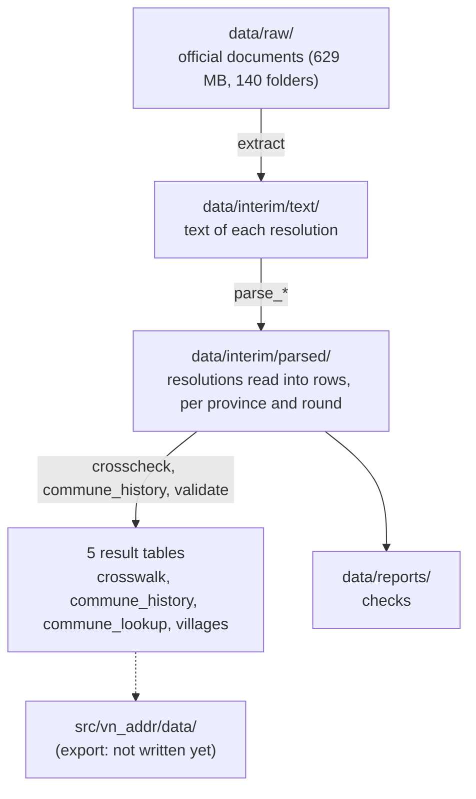
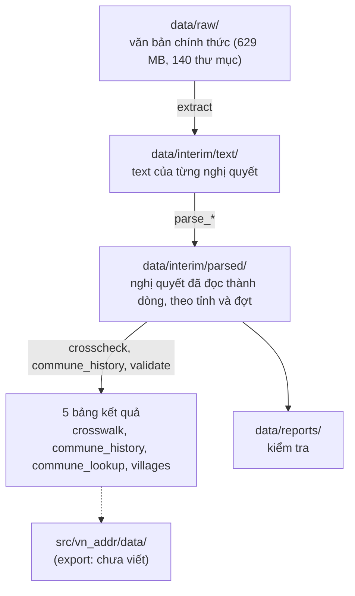

# Pipeline data

**English** | [Tiếng Việt](#tiếng-việt)

The documents the pipeline downloads, what it reads out of them, and the checks it runs, from the official texts to the tables the library will ship. The library's own data folder (`src/vn_addr/data/`) is still empty: the `export` step is not written yet.

## Layout

- **Five files are the result.** About 2,400 files sit under `data/` (2,043 of them downloaded documents), but most are the same kind of file repeated for each province and round. The tables below say which ones matter.
- **Everything here can be rebuilt.** `data/raw/` is filled again from `data/raw/manifest.json` (`uv run python -m pipeline.fetch`), and every later file by its pipeline step. `data/raw/*` (except the manifest) and `data/interim/` are not committed.

## data/raw/: official documents

| Folder | Contents |
|---|---|
| `national/` | Decision 19/2025/QĐ-TTg (34 provinces, 3,321 communes) and the **Statistics Office new–old conversion table** (`nso_chuyen_doi_moi_cu.xlsx`), the main source of the commune mapping |
| `<province>/`, e.g. `ninh-binh/` | Standing Committee resolution of the **2025 round** for each new province (34 folders) |
| `<province>-2024/` | Resolutions of the **2023–2025 round**, by old province (53 folders) |
| `<province>-2020/` | Resolutions of the **2019–2021 round**, by old province (51 folders) |
| `villages/` | Village-level resolutions: Nam Định 2021 (scanned) and Ninh Bình 2026 |
| `manifest.json` | One entry per file: URL, sha256, time fetched and download tier |

- **A resolution usually comes in three files.** The signed PDF (`*.signed.pdf`) is a scan and is kept as the reference copy; the Official Gazette (Công báo) PDF and DOC have a text layer and are the ones the pipeline reads.

## data/interim/: intermediate files

| File or folder | Contents |
|---|---|
| `text/` | Text extracted from each resolution, in the same folders as `raw/` |
| `ubtvqh14_titles.csv`, `ubtvqh15_titles.csv` | Title of every Standing Committee document found by walking the Công báo ids, used to find the resolutions |
| `admin_unit_resolutions_*.csv`, `rearrangement_resolutions*.csv` | The resolutions picked out of those titles |
| `ocr/`, `audit/` | OCR output and cut-out images for reading the Nam Định 2021 village tables again |
| `parsed/<province>.csv` (34) | 2025 resolutions read into rows: which old commune goes into which new one, by clause |
| `parsed/<province>-2024.csv` (53), `-2020.csv` (51) | The earlier rounds, read the same way |

- **The per-province files are input, not output.** They are worth opening only to see how one clause was read.

## The result tables (data/interim/parsed/)

| File | Rows | What it answers |
|---|---:|---|
| **`crosswalk.csv`** | 10,566 | **Old commune (before 1 July 2025) → new commune**, with codes and whether all or part of it moved. The Statistics Office table, normalised and with the corrections of `crosswalk_corrections.csv` applied (3 rows, marked in the `correction` column): the main mapping. |
| **`commune_history.csv`** | 12,000 | **Each commune of 2019 followed to 2025**: one row per (commune of 2019, commune of 2025), with every step's document, clause and effective date. |
| **`commune_lookup.csv`** | 33,720 | Short form of the history for lookups: a commune's name **as it stood in 2019, 2020 or 2024** → its new commune. For old addresses written at any of those times. |
| **`villages-nam-dinh-2021.csv`** | 2,509 | Nam Định villages, 2021 round: old village → new village, with page and OCR evidence. |
| **`villages-ninh-binh.csv`** | 625 | Ninh Bình villages, 2026 round, from the 15 of 129 communes that published their resolution. |

- **`crosswalk` covers the last step, the history the steps before it.** `commune_history` and `commune_lookup` follow a commune from 2019 to the state just before 1 July 2025 through the resolutions, then take the last step from `crosswalk`. The two village files go one level below the commune.
- **A commune has a type as well as a name.** `thị trấn Đầm Hà` and `xã Đầm Hà` of the same district are two communes, so the lookup keeps `commune_type` (`xa`, `phuong`, `thi_tran`) and `district_type` (`huyện`, `thị xã`, `thành phố`, `quận`) next to the names.

### Worked example: xã Yên Mật, huyện Kim Sơn (Ninh Bình)

Resolution 861/NQ-UBTVQH14 (effective 1 February 2020) moved part of xã Yên Mật into xã Kim Chính (Điều 1, khoản 1, điểm b) and the rest into xã Như Hòa (điểm c). `commune_history.csv` therefore has two rows for it:

| Commune of 2019 | Step 2019–2021 | 1 July 2025 (Statistics Office table) | Partial |
|---|---|---|---|
| xã Yên Mật, huyện Kim Sơn | part → xã Kim Chính (861, khoản 1, điểm b) | Xã Phát Diệm (14620) | True |
| xã Yên Mật, huyện Kim Sơn | part → xã Như Hòa (861, khoản 1, điểm c) | Xã Quang Thiện (14647) | True |

An address still written "xã Yên Mật, huyện Kim Sơn" finds both rows in `commune_lookup.csv` under `as_of = 2019`, and the converter will have to return both candidates.

## data/reports/: checks

| File | Question it answers |
|---|---|
| `parse_summary.json` | Were the 34 resolutions of 2025 read completely, and do the commune totals match? |
| `crosscheck_crosswalk.csv` | Where do the 2025 resolutions and the Statistics Office table disagree? (10,560 rows agree; the others wait for review) |
| `parse_2024_summary.json` | For the 2019–2025 rounds: do the commune counts per district and per province match what each resolution states? (96 of 104 folders match every check) |
| `unparsed.csv` | Which sentences could not be read (none at present) |
| `villages-*.json`, `villages-review.csv` | Checks on the village data, and the rows to read again |

## Decision files (pipeline/)

Reviewed decisions, kept next to the code that reads them:

| File | Role |
|---|---|
| `sources.csv` | The 164 resolutions to fetch (70 of 2019–2021, 60 of 2023–2025, 34 of 2025), listed by `pipeline.registry` from the Công báo scans |
| `name_aliases.csv` | Names the resolutions spell differently from the Statistics Office table; the table's spelling is kept (3 rows) |
| `crosswalk_corrections.csv` | Errors in the Statistics Office table, corrected field by field with the document that shows the right value; a correction applies only while the table still holds the wrong value (5 fields of 3 rows) |
| `accepted_discrepancies.csv` | Count mismatches reviewed and accepted, with the reason (2 rows: the commune total of Thái Nguyên 2020, the 4 communes of Tân Uyên) |

## Known limits

- **Districts merged from several.** When a district absorbed others (huyện Yên Dũng into thành phố Bắc Giang, Lộc Hà into Thạch Hà, Nam Đông into Phú Lộc and others), no document says which old district each unchanged commune was in. Those communes are found only under the district they merged into. The commune codes do not settle it either: codes follow the districts as they were when the codes were assigned (huyện Nông Sơn, split from Quế Sơn in 2008, kept Quế Sơn codes), and an assignment by code does not reproduce the per-district counts the resolutions state.
- **Documents not found.** The resolutions forming thành phố Phổ Yên (469/NQ-UBTVQH15) and thành phố Tân Uyên (725/NQ-UBTVQH15) are not on Công báo, on vanban.chinhphu.vn or on the provincial portals. Without them, the commune total of Thái Nguyên after 2019–2021 is off by one, and four communes of Tân Uyên (Hội Nghĩa, Phú Chánh, Tân Vĩnh Hiệp, Vĩnh Tân) are not followed to 2025; both are recorded in `accepted_discrepancies.csv`.
- **Errors in the Statistics Office table.** The published table lists Phường 4 of thành phố Tân An under Tiền Giang instead of Long An, xã Tiên Hải of thành phố Hà Tiên under An Giang instead of Kiên Giang, and xã Tiên Sơn (thị xã Duy Tiên) as a ward. `crosswalk.csv` carries the corrected values from `crosswalk_corrections.csv`; the downloaded file is left as published.

---

# Tiếng Việt

Các văn bản pipeline tải về, những gì đọc ra từ chúng và các phép kiểm tra, từ văn bản chính thức tới các bảng mà thư viện sẽ ship. Thư mục dữ liệu của thư viện (`src/vn_addr/data/`) hiện vẫn trống: bước `export` chưa viết.

## Cấu trúc

- **Kết quả nằm ở năm file.** Trong `data/` có khoảng 2.400 file (2.043 file là văn bản tải về), nhưng phần lớn là cùng một loại file lặp lại cho từng tỉnh và từng đợt. Các bảng dưới đây cho biết file nào quan trọng.
- **Mọi thứ ở đây đều sinh lại được.** `data/raw/` được tải lại từ `data/raw/manifest.json` (`uv run python -m pipeline.fetch`), các file sau đó do từng bước của pipeline sinh ra. `data/raw/*` (trừ manifest) và `data/interim/` không commit.

## data/raw/: văn bản chính thức

| Thư mục | Nội dung |
|---|---|
| `national/` | Quyết định 19/2025/QĐ-TTg (34 tỉnh, 3.321 xã) và **bảng chuyển đổi mới–cũ của Cục Thống kê** (`nso_chuyen_doi_moi_cu.xlsx`), nguồn chính của mapping xã |
| `<tỉnh>/`, ví dụ `ninh-binh/` | Nghị quyết UBTVQH **đợt 2025** của từng tỉnh mới (34 thư mục) |
| `<tỉnh>-2024/` | Nghị quyết **đợt 2023–2025**, theo tỉnh cũ (53 thư mục) |
| `<tỉnh>-2020/` | Nghị quyết **đợt 2019–2021**, theo tỉnh cũ (51 thư mục) |
| `villages/` | Văn bản cấp thôn: Nam Định 2021 (bản scan) và Ninh Bình 2026 |
| `manifest.json` | Mỗi file một mục: URL, sha256, thời điểm tải và bậc nguồn |

- **Một nghị quyết thường có ba file.** Bản ký số (`*.signed.pdf`) là bản scan, giữ làm bản đối chiếu; bản Công báo dạng PDF và DOC có lớp text và là bản pipeline đọc.

## data/interim/: file trung gian

| File hoặc thư mục | Nội dung |
|---|---|
| `text/` | Text rút từ từng nghị quyết, cùng cấu trúc thư mục với `raw/` |
| `ubtvqh14_titles.csv`, `ubtvqh15_titles.csv` | Tiêu đề mọi văn bản UBTVQH tìm được khi duyệt id Công báo, dùng để tìm nghị quyết |
| `admin_unit_resolutions_*.csv`, `rearrangement_resolutions*.csv` | Các nghị quyết lọc ra từ những tiêu đề đó |
| `ocr/`, `audit/` | Kết quả OCR và ảnh cắt để đọc lại bảng thôn Nam Định 2021 |
| `parsed/<tỉnh>.csv` (34) | Nghị quyết 2025 đã đọc thành dòng: xã cũ nào vào xã mới nào, theo từng khoản |
| `parsed/<tỉnh>-2024.csv` (53), `-2020.csv` (51) | Các đợt trước, đọc theo cùng cách |

- **File theo tỉnh là đầu vào, không phải kết quả.** Chỉ cần mở khi muốn xem một khoản được đọc ra sao.

## Các bảng kết quả (data/interim/parsed/)

| File | Số dòng | Trả lời câu hỏi |
|---|---:|---|
| **`crosswalk.csv`** | 10.566 | **Xã cũ (trước 01/7/2025) → xã mới**, kèm mã và việc nhập toàn bộ hay một phần. Bảng của Cục Thống kê đã chuẩn hóa và áp các đính chính trong `crosswalk_corrections.csv` (3 dòng, đánh dấu ở cột `correction`): mapping chính. |
| **`commune_history.csv`** | 12.000 | **Từng xã năm 2019 đi tới 2025**: mỗi dòng là một cặp (xã năm 2019, xã năm 2025), kèm văn bản, khoản và ngày hiệu lực của từng bước. |
| **`commune_lookup.csv`** | 33.720 | Dạng rút gọn của lịch sử để tra: tên xã **như ở năm 2019, 2020 hoặc 2024** → xã mới. Dùng cho địa chỉ cũ ghi ở bất kỳ mốc nào trong số đó. |
| **`villages-nam-dinh-2021.csv`** | 2.509 | Thôn Nam Định đợt 2021: thôn cũ → thôn mới, kèm trang và bằng chứng OCR. |
| **`villages-ninh-binh.csv`** | 625 | Thôn Ninh Bình đợt 2026, từ 15/129 xã đã đăng nghị quyết. |

- **`crosswalk` lo bước cuối, lịch sử lo các bước trước đó.** `commune_history` và `commune_lookup` đi theo một xã từ 2019 tới trạng thái ngay trước 01/7/2025 qua các nghị quyết, rồi lấy bước cuối từ `crosswalk`. Hai file thôn đi xuống dưới cấp xã.
- **Xã có loại chứ không chỉ có tên.** `thị trấn Đầm Hà` và `xã Đầm Hà` cùng huyện là hai xã, nên bảng tra giữ `commune_type` (`xa`, `phuong`, `thi_tran`) và `district_type` (`huyện`, `thị xã`, `thành phố`, `quận`) bên cạnh tên.

### Ví dụ: xã Yên Mật, huyện Kim Sơn (Ninh Bình)

Nghị quyết 861/NQ-UBTVQH14 (hiệu lực 01/02/2020) chuyển một phần xã Yên Mật vào xã Kim Chính (Điều 1, khoản 1, điểm b) và phần còn lại vào xã Như Hòa (điểm c). Vì vậy `commune_history.csv` có hai dòng cho xã này:

| Xã năm 2019 | Bước 2019–2021 | 01/7/2025 (bảng Cục Thống kê) | Một phần |
|---|---|---|---|
| xã Yên Mật, huyện Kim Sơn | một phần → xã Kim Chính (861, khoản 1, điểm b) | Xã Phát Diệm (14620) | True |
| xã Yên Mật, huyện Kim Sơn | một phần → xã Như Hòa (861, khoản 1, điểm c) | Xã Quang Thiện (14647) | True |

Một địa chỉ còn ghi "xã Yên Mật, huyện Kim Sơn" tìm thấy cả hai dòng trong `commune_lookup.csv` với `as_of = 2019`, và bộ chuyển đổi sẽ phải trả về cả hai ứng viên.

## data/reports/: kiểm tra

| File | Trả lời câu hỏi |
|---|---|
| `parse_summary.json` | 34 nghị quyết 2025 đã đọc hết chưa, tổng số xã có khớp không? |
| `crosscheck_crosswalk.csv` | Nghị quyết 2025 và bảng Cục Thống kê lệch nhau ở đâu? (10.560 dòng khớp; các dòng còn lại chờ duyệt) |
| `parse_2024_summary.json` | Với các đợt 2019–2025: số xã từng huyện và từng tỉnh có khớp số mỗi nghị quyết ghi không? (96/104 thư mục khớp mọi kiểm tra) |
| `unparsed.csv` | Câu nào chưa đọc được (hiện không còn) |
| `villages-*.json`, `villages-review.csv` | Kiểm tra dữ liệu thôn và các dòng cần đọc lại |

## File quyết định (pipeline/)

Các quyết định đã duyệt, đặt cạnh code đọc chúng:

| File | Vai trò |
|---|---|
| `sources.csv` | 164 nghị quyết cần tải (70 đợt 2019–2021, 60 đợt 2023–2025, 34 đợt 2025), do `pipeline.registry` lập từ các lần quét Công báo |
| `name_aliases.csv` | Tên nghị quyết viết khác bảng Cục Thống kê; giữ cách viết của bảng (3 dòng) |
| `crosswalk_corrections.csv` | Lỗi trong bảng Cục Thống kê, đính chính theo từng trường kèm văn bản chứng minh giá trị đúng; một đính chính chỉ áp khi bảng vẫn còn giá trị sai đã ghi (5 trường của 3 dòng) |
| `accepted_discrepancies.csv` | Chỗ lệch số lượng đã duyệt và chấp nhận, kèm lý do (2 dòng: tổng số xã Thái Nguyên 2020, 4 xã của Tân Uyên) |

## Giới hạn đã biết

- **Huyện gộp từ nhiều huyện.** Khi một huyện nhận thêm huyện khác (huyện Yên Dũng vào thành phố Bắc Giang, Lộc Hà vào Thạch Hà, Nam Đông vào Phú Lộc và một số nơi khác), không văn bản nào ghi xã không đổi nào thuộc huyện cũ nào. Các xã đó chỉ tìm được dưới tên huyện nhận. Mã xã cũng không giải quyết được: mã đi theo huyện ở thời điểm cấp mã (huyện Nông Sơn tách từ Quế Sơn năm 2008 vẫn giữ mã của Quế Sơn), và gán theo mã không khớp số xã từng huyện mà các nghị quyết ghi.
- **Văn bản chưa tìm được.** Nghị quyết lập thành phố Phổ Yên (469/NQ-UBTVQH15) và thành phố Tân Uyên (725/NQ-UBTVQH15) không có trên Công báo, trên vanban.chinhphu.vn và trên cổng thông tin của tỉnh. Thiếu hai văn bản này, tổng số xã của Thái Nguyên sau đợt 2019–2021 lệch 1, và bốn xã của Tân Uyên (Hội Nghĩa, Phú Chánh, Tân Vĩnh Hiệp, Vĩnh Tân) chưa nối được tới 2025; cả hai được ghi trong `accepted_discrepancies.csv`.
- **Lỗi trong bảng Cục Thống kê.** Bảng đã công bố ghi Phường 4 của thành phố Tân An thuộc tỉnh Tiền Giang thay vì Long An, xã Tiên Hải của thành phố Hà Tiên thuộc tỉnh An Giang thay vì Kiên Giang, và xã Tiên Sơn (thị xã Duy Tiên) là phường. `crosswalk.csv` mang giá trị đã đính chính từ `crosswalk_corrections.csv`; file tải về giữ nguyên như đã công bố.
